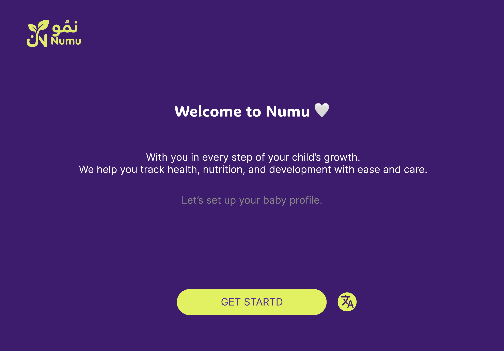
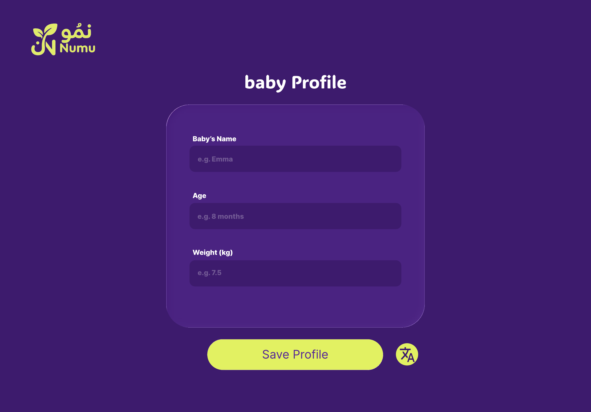
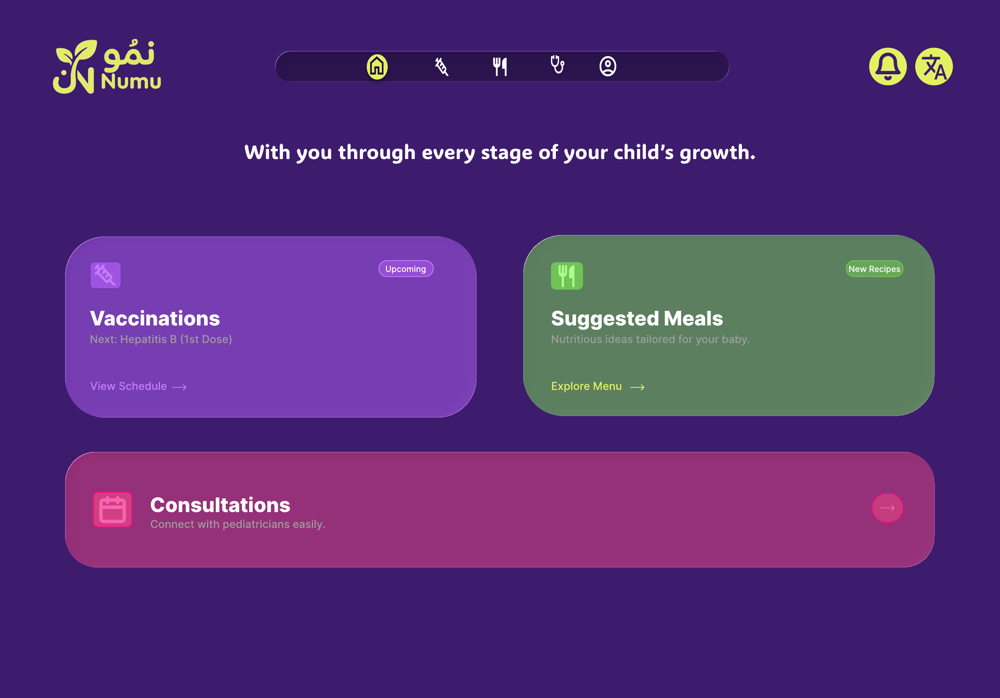
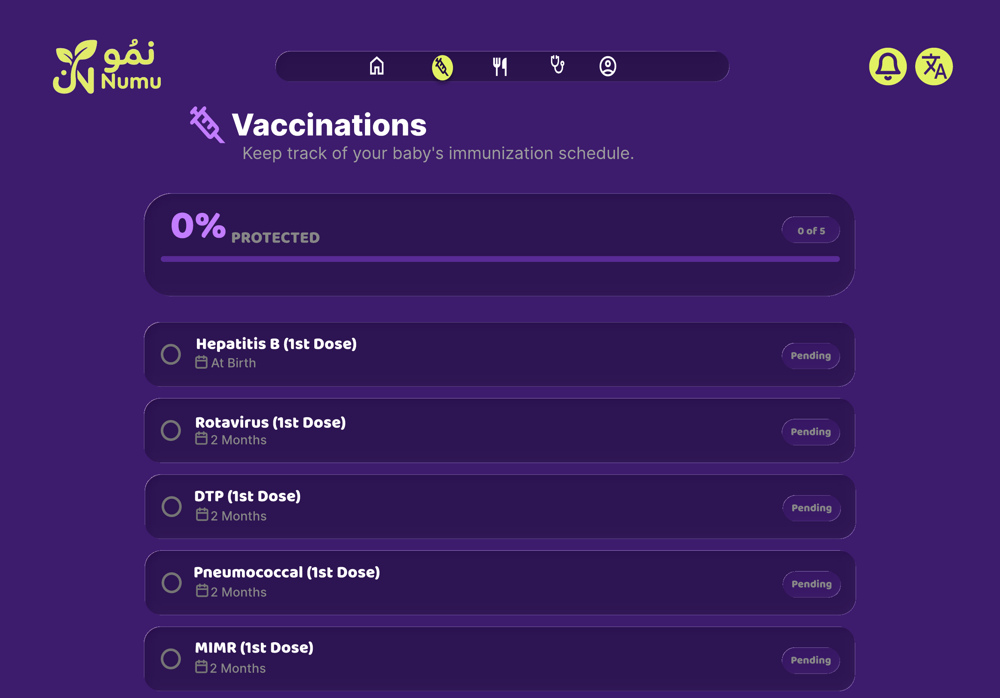
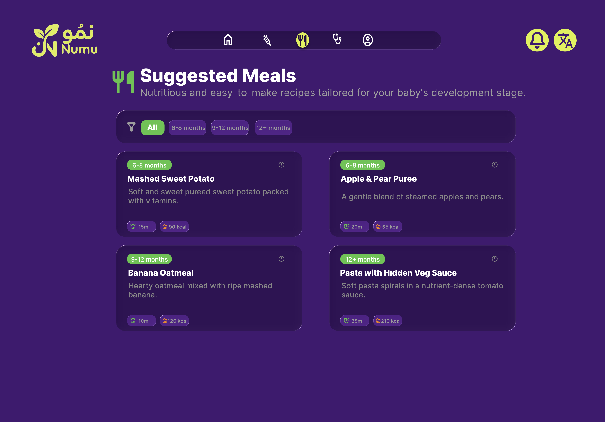
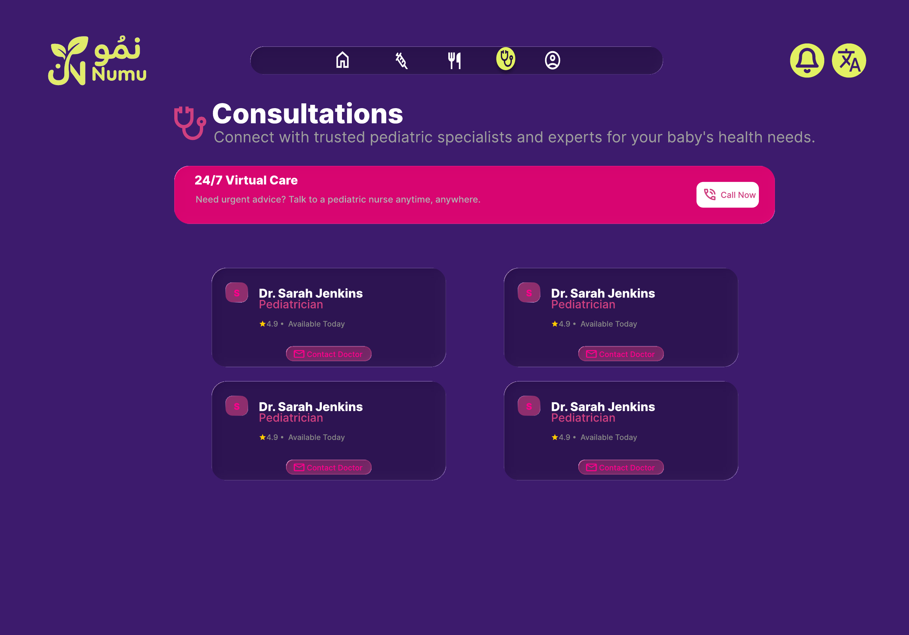
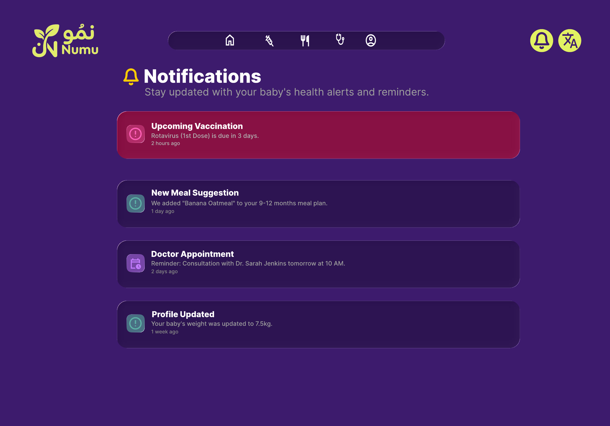
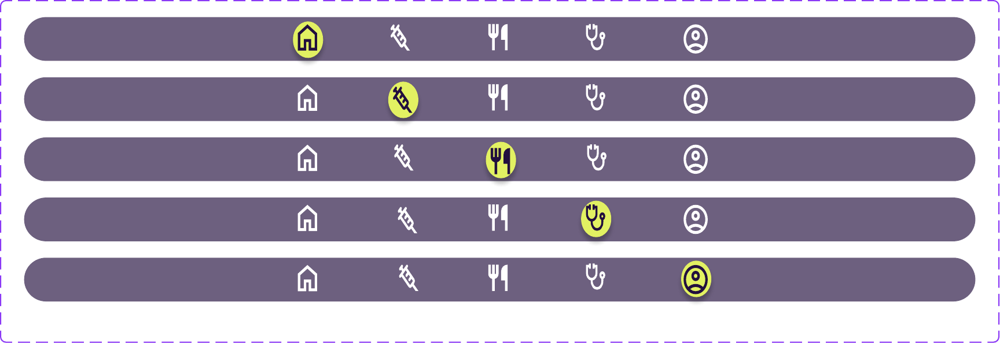

# Numu | نُمُو

**A baby care platform concept: high-fidelity UI/UX design created in Figma.**

  

---

## Table of Contents

1. [Project Overview](#project-overview)
2. [Problem Statement](#problem-statement)
3. [Project Goals](#project-goals)
4. [Target Audience](#target-audience)
5. [Key Design Features](#key-design-features)
6. [UI/UX Design Highlights](#uiux-design-highlights)
7. [Design System and Color Palette](#design-system-and-color-palette)
8. [Screenshots / UI Preview](#screenshots--ui-preview)
9. [Figma Design Link](#figma-design-link)
10. [Project Scope and Limitations](#project-scope-and-limitations)
11. [Future Development Possibilities](#future-development-possibilities)
12. [Credits](#credits)

---

## Project Overview

**Numu (نُمُو)** is a concept for a baby care platform that helps parents follow their child's growth through three organized areas:

- **Vaccinations:** a schedule view for tracking a baby's immunizations.
- **Suggested Meals:** age-grouped meal ideas (6–8, 9–12, and 12+ months).
- **Consultations:** a space to connect with pediatric professionals.

The word *numu* means "growth" in Arabic. The logo reflects this by combining the Arabic letter **ن** and the Latin letter **N** with a sprout motif.

This repository documents the **interface design only**. It is a UI/UX design project, not a coded application.

## Problem Statement

Parents of infants and toddlers manage many time-sensitive tasks at once: remembering vaccination dates, choosing foods suited to their child's age, and finding reliable pediatric advice. These tasks are often handled across separate sources.

Numu explores how one clear, friendly interface could bring these needs together.

## Project Goals

- Design a calm, welcoming interface for a sensitive, parent-focused topic.
- Organize vaccination, nutrition, and consultation features under one clear navigation structure.
- Establish a recognizable bilingual brand identity (Arabic and English).
- Build a consistent visual language with reusable components.
- Demonstrate high-fidelity UI design, including feedback states such as validation errors and notifications.

## Target Audience

**Primary audience:** parents and caregivers of infants and young children (the meal content spans roughly 6 months and older).

**Needs addressed by the design:**
- A quick overview of what is coming up next.
- Simple data entry (a short baby profile).
- Content grouped by the child's age.
- Easy access to professional advice.

## Key Design Features

The features below are **visual designs**. None of them is functional (see [Project Scope and Limitations](#project-scope-and-limitations)).

| Screen | Purpose | Design elements |
|---|---|---|
| **Logo / Splash** | Brand introduction | Bilingual logo (Arabic wordmark, Latin wordmark, sprout "N" mark) on deep purple |
| **Welcome** | Onboarding entry point | Welcome message, short value statement, primary call-to-action, language toggle |
| **Baby Profile** | Collect basic baby details | Form with name, age, and weight (kg); feedback banner states (error and confirmation styling) |
| **Home Dashboard** | Central hub | Feature cards for Vaccinations ("Upcoming" tag), Suggested Meals ("New Recipes" tag), and Consultations |
| **Vaccinations** | Immunization schedule view | Progress summary (0 of 5), list of vaccines with timing and "Pending" status chips |
| **Suggested Meals** | Age-appropriate meal ideas | Age filter chips (All, 6–8, 9–12, 12+ months), recipe cards with prep time and calories |
| **Consultations** | Access to pediatric support | "24/7 Virtual Care" banner with a call button, doctor profile cards with a contact button |
| **Notifications** | Alerts and reminders | Prioritized list: vaccination, meal suggestion, appointment, and profile update items |
| **Navigation States** | Navigation component | Five-icon pill bar (Home, Vaccinations, Meals, Consultations, Profile) with an active-state highlight for each |

## UI/UX Design Highlights

- **Clear information architecture.** A single top navigation bar provides five consistent destinations, and each screen shares the same header (logo, navigation, notifications, language toggle).
- **Color-coded feature areas.** Vaccinations (violet), Meals (green), and Consultations (pink/magenta) each have their own color, so users can tell sections apart at a glance.
- **At-a-glance status.** Tags such as "Upcoming" and "Pending", plus a progress bar, make state visible without reading detail.
- **Age-based filtering.** Meal cards carry age labels, and filter chips let parents narrow the list to their child's stage.
- **Designed feedback states.** The profile form includes validation banners, and the notifications list uses stronger color to signal urgency.
- **Friendly, modern styling.** Large rounded corners, soft translucent card surfaces, and a rounded display style for headings give a welcoming tone.
- **Bilingual brand.** The identity pairs Arabic and Latin forms, and a language toggle is placed in the header across screens.

## Design System and Color Palette

The design uses a **dark theme** with a deep purple base and a lime accent.

| Role | Description | Approx. value |
|---|---|---|
| Background | Deep purple base | `#3D1C6B` |
| Surface | Darker purple for cards, nav, and fields | `#2B1450` |
| Primary accent | Lime, used for buttons, active navigation, and the logo | `#E2F25F` |
| Vaccinations | Violet card | `#7B3FB5` |
| Meals | Green card and age tags | `#5E8060` / `#6CC24A` |
| Consultations | Magenta/pink card and banner | `#9A3278` / `#D6006F` |

**Typography:** a clean sans-serif for body text, paired with a rounded display style for headings.

**Core components:**
- Pill navigation bar with active state
- Large rounded cards
- Status and age chips
- Filter chips
- Progress bar
- Form fields
- Circular icon buttons (notifications, language)
- Banners (feedback and promotional)

## Screenshots / UI Preview

| | |
|---|---|
|  |  |
| Welcome | Baby Profile |
|  |  |
| Home Dashboard | Vaccinations |
|  |  |
| Suggested Meals | Consultations |
|  |  |
| Notifications | Navigation States |

## Figma Design Link

[Open the Numu design in Figma]([FIGMA_LINK_HERE](https://www.figma.com/design/R7CEzH7ejRRBIlOEqvxbSe/%D9%86%D9%85%D9%88?node-id=0-1&t=7mbXiLnWdcvH0hFv-1))

## Project Scope and Limitations

**Classification:** UI/UX Design, high-fidelity interface design.

This project **includes**:
- Visual interface designs for the screens listed above.
- A bilingual brand identity and logo.
- A set of reusable visual components.

This project **does not include**:
- Frontend or backend implementation.
- Database or authentication.
- Working vaccination reminders or notifications.
- Meal recommendation logic.
- Functional consultation, calling, or messaging services.
- A deployed application.

**Additional notes:**
- All content (doctor names, ratings, nutritional values, vaccine lists, notification text) is **placeholder content for design purposes**. It is not medical, nutritional, or clinical guidance. Vaccination schedules vary by country and should be defined with qualified professionals.
- The design is currently dark-themed only.
- Arabic (right-to-left) interface screens are not part of the current file, although the brand is bilingual and a language toggle is shown.
- A dedicated Profile screen is not yet designed, although a Profile icon appears in the navigation.

## Future Development Possibilities

- Light theme variant.
- Full Arabic interface with right-to-left layouts.
- Mobile-specific layouts and responsive variants.
- A Profile/account screen and meal detail screens.
- Child development and behavior guidance content.
- An interactive Figma prototype connecting the existing screens.
- An accessibility review (color contrast and text sizes).
- Content review by qualified pediatric professionals.
- Implementation as a separate phase, if the concept is developed further.

## Credits

**Design:** AUTHOR_NAME
**Role:** UI/UX Design (replace if needed)
**Tool:** Figma
**Contact:** CONTACT_OR_PORTFOLIO_LINK

---

*Numu | نُمُو is a design concept. It is not a live product.*
